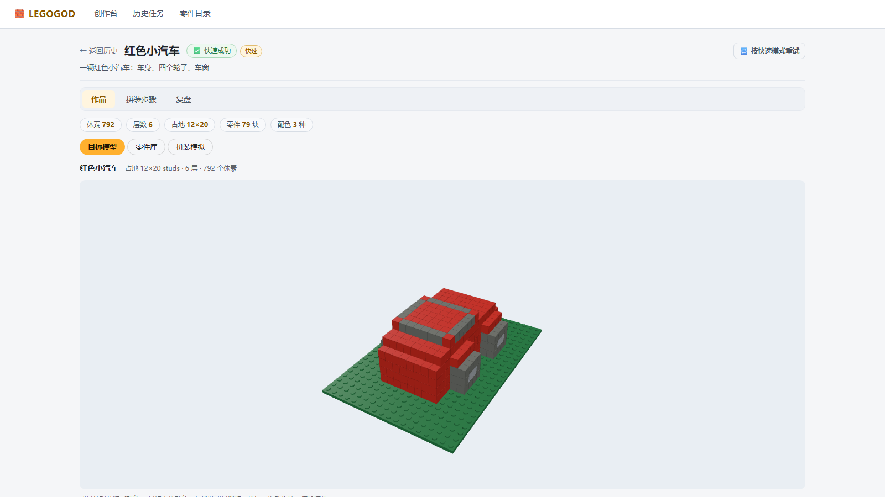
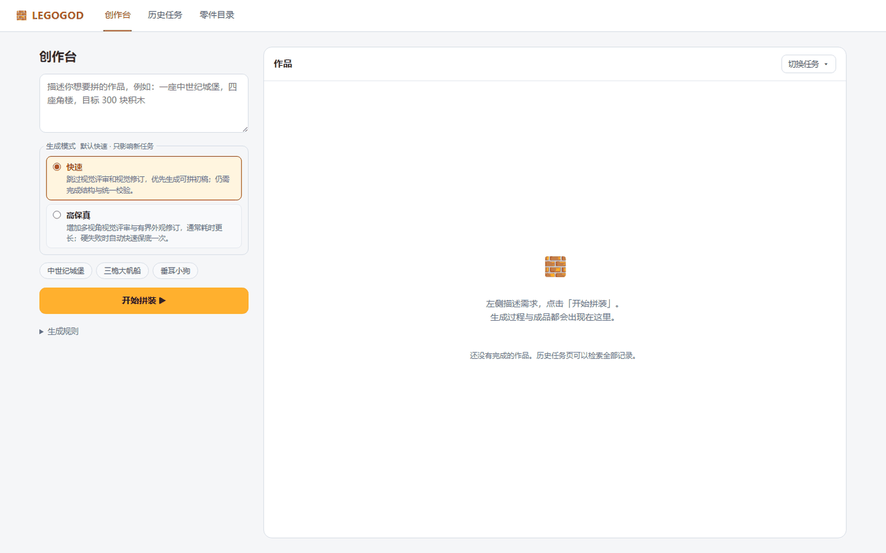
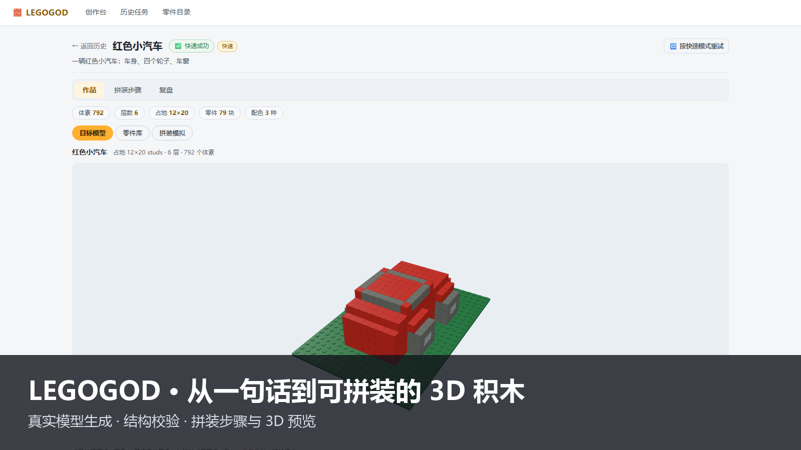
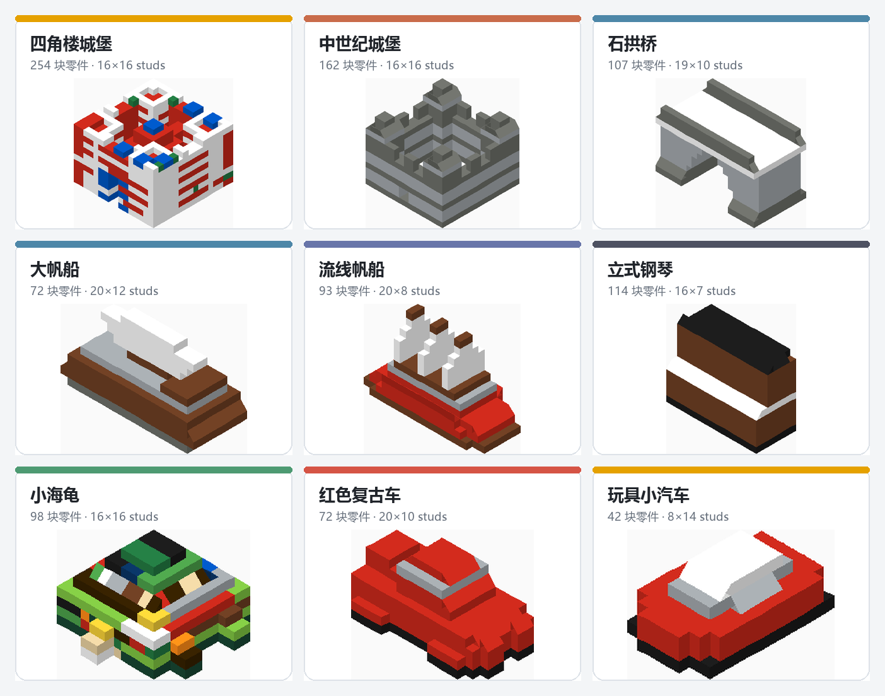
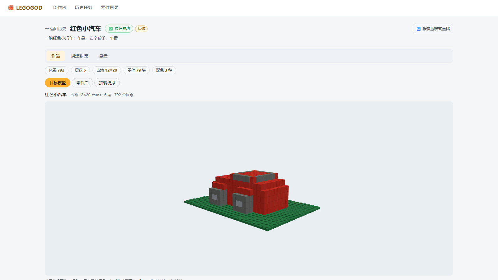
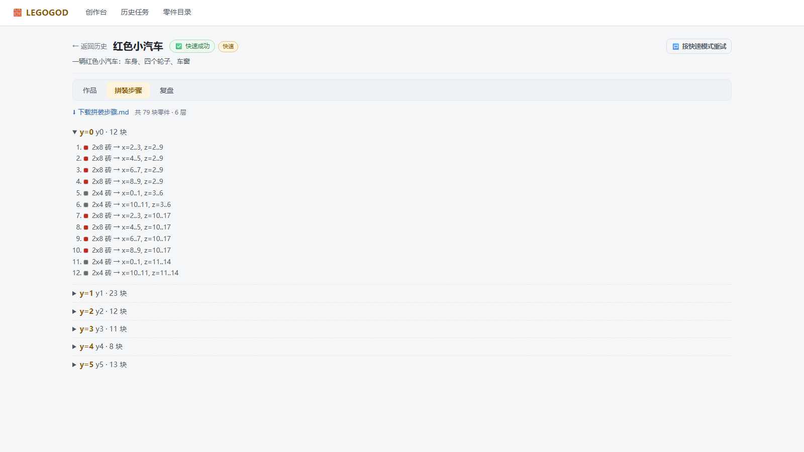
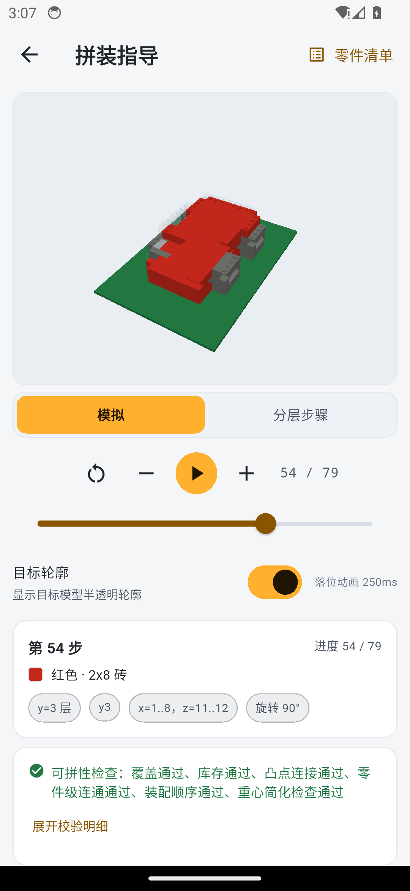

# LEGOGOD · Turn One Sentence into a Buildable 3D Brick Creation

[简体中文](README.md) · English

[](https://github.com/jensen666/legogod/actions/workflows/ci.yml)
[](LICENSE)
[](pyproject.toml)

**Describe what you want in one sentence and get a 3D brick creation you can inspect, validate, and assemble step by step.**

LEGOGOD does not ask the model to "draw" bricks directly. The model only produces a structured design; a fixed program-driven pipeline then performs part checks, solves precise brick tiling, and runs unified validation, finally outputting assembly steps with a parts list and a rotatable 3D view. Once generation finishes, you can check the exact position of every layer and every brick — and why it can actually be built.



## Video Demo

**No installation needed — watch how a complete creation is generated first.** The GIF plays directly on the page; download the full MP4 when you need to pause, scrub, or watch offline.



[](https://github.com/jensen666/legogod/releases/download/v1.0.0/legogod-demo.mp4)

**[▶ Watch / download the full MP4](https://github.com/jensen666/legogod/releases/download/v1.0.0/legogod-demo.mp4)** · 19 seconds · H.264

> Recorded from the same real job on the same version, with the long waits sped up. GitHub does not guarantee inline playback of Release MP4s on every page, so the full flow is shown here as a GIF, with the MP4 available for download — no redirect to third-party platforms.

## 9 Real Creations, All in One View



These are not illustrations or mocks: every public model has been re-solved through real brick tiling and verified for coverage, stock, stud connectivity, part-level connectivity, assembly order, and stability. Click a creation to view it full size; the source model can also be inspected directly.

| Creation | Parts | Source model | Creation | Parts | Source model |
|---|---:|---|---|---:|---|
| [Medieval Castle](assets/showcase/mid-castle.png) | 162 | [JSON](test/fixtures/public/models/model_mid-castle.json) | [Floppy-eared Dog](assets/showcase/yellow-floppy-dog.png) | 73 | [JSON](test/fixtures/public/models/model_yellow-floppy-dog.json) |
| [Red Apple](assets/showcase/red-apple-stem.png) | 70 | [JSON](test/fixtures/public/models/model_red-apple-stem.json) | [Streamline Galleon](assets/showcase/streamline-galleon.png) | 93 | [JSON](test/fixtures/public/models/model_streamline-galleon.json) |
| [Three-masted Galleon](assets/showcase/three-mast-galleon-v3.png) | 137 | [JSON](test/fixtures/public/models/model_three-mast-galleon-v3.json) | [Red Retro Car](assets/showcase/red-retro-car.png) | 72 | [JSON](test/fixtures/public/models/model_red-retro-car.json) |
| [Four-corner-tower Castle](assets/showcase/medieval-corner-towers-castle.png) | 254 | [JSON](test/fixtures/public/models/model_medieval-corner-towers-castle.json) | [Stone Arch Bridge](assets/showcase/arch-bridge.png) | 107 | [JSON](test/fixtures/public/models/model_arch-bridge.json) |
| [Small Bridge](assets/showcase/small-bridge.png) | 64 | [JSON](test/fixtures/public/models/model_small-bridge.json) | | | |

Want to reproduce these showcase images? Run `python -m tools.render_showcase` to re-solve and regenerate all cards and the nine-image grid.

## Why It Is Worth a Try

- **A fixed program pipeline, not a one-shot gamble**: the model outputs a constrained protocol, and the program handles compilation, gates, pre-checks, solving, and unified validation; if validation fails it fails honestly, instead of treating "looks like it" as "can be built".
- **It really can be built**: every brick is solved against real stud connections, with coverage, stock, part-level connectivity, assembly order, suspension physics, and stability checked item by item.
- **Two generation modes**: fast mode prioritizes getting an initial buildable draft; fidelity mode adds multi-view visual review and bounded appearance revision, with exactly one automatic fast fallback on a hard failure.
- **From creation to instruction manual**: layered assembly steps (including pre-assembled sub-modules) and a parts list are generated automatically, and the 3D view can be replayed layer by layer.
- **Web + Android**: the browser app covers creation/history/3D/steps; the Android app connects to the same server API with native 3D rendering, without wrapping the whole site in a WebView.

## Real Results





The Web detail, steps, and app screenshots in this section come from the same real job: prompt → model generation → structural validation → precise solve → steps and 3D artifacts; the nine-image grid above comes from nine separate real solves of public models. Generation quality fluctuates, and the project does not cherry-pick results and then claim a universal success rate.

## 60-Second Quick Start

Environment: Python 3.10+, plus a model service compatible with the OpenAI Chat Completions protocol (bring your own).

```bash
# 1. Install (full functionality, including Pillow rendering)
python -m pip install -e ".[pillow]"

# 2. Configure the model: copy the template and fill in your service URL, key, and model name
cp .env.example .env        # Windows: Copy-Item .env.example .env

# 3. Start
python -m legogod
```

Open <http://127.0.0.1:8600>, enter a prompt (for example, "a medieval castle with four corner towers, target 300 bricks"), choose a generation mode, and click "Start building".

- If you only need the fast pipeline without rendering, use the basic install `python -m pip install -e .`.
- Development and testing: `python -m pip install -e ".[pillow]"`, then `python -m pip install -r requirements-dev.txt`.
- For detailed steps and FAQ, see [Quick Start](docs/quickstart.md); for deployment and security, see [Deployment and Security](docs/deployment.md).
- Chart-analysis tools install via `.[charts]`; real-browser E2E via `.[e2e-browser]` (both optional and not part of the default tests).

## How It Works

```text
prompt → model planning and design (constrained JSON protocol)
      → program compiles voxels + part binding + part prominence gate
      → design pre-check (support/connectivity/scale)
      → precise brick tiling solve (stock + stud connectivity + staggered seams)
      → unified validation (coverage/stock/connectivity/part connectivity/assembly/suspension/stability)
      → assembly steps Markdown + 3D view
```

The model does the "thinking"; the program decides "can it be built". For the full description, see [How It Works](docs/architecture.md).

## Web and Android

| Client | Capabilities | Notes |
|---|---|---|
| Web | Creation studio, job history, job detail (3D / assembly steps / run log), parts catalog | Desktop multi-page layout with a dedicated URL per page; 3D uses Three.js (pinned-version CDN; the first load needs network) |
| Android app | Creation, creation list and search, 3D creation, layered assembly guidance, parts list, generation records | Native Flutter implementation connecting to the real server API v1; build and version notes in [app/README.md](app/README.md) |

Android currently provides only an Android project (no iOS build or signing). The real-device automation acceptance scope and uncovered items are recorded honestly in the app documentation.

| Android · Creation | Android · Layered assembly guidance |
|---|---|
|  |  |

## Tests

```bash
python -m pip install -e ".[pillow]"
python -m pip install -r requirements-dev.txt
python -m pytest test -q
```

- Core tests do not call a real model; rendering-related cases require Pillow.
- Some frontend tests require Node.js.
- Public CI validates the public test-fixture manifest (counts and SHA-256) and forbids silently skipped cases.
- Real-LLM E2E, long browser E2E, and on-device E2E do not run in the default CI.

## Security and Known Limitations

- Model keys live only in the local `.env` or environment variables, never in pages or the repository; `.env` is excluded by ignore rules.
- The service listens on a loopback address by default; listening on a non-loopback address requires an access token, and public deployment requires an HTTPS same-origin reverse proxy. See [Deployment and Security](docs/deployment.md).
- Generation quality fluctuates: real-model output may be degraded, fall back, or fail; the fixed pipeline guarantees "not validated means not successful", not that every prompt succeeds on the first attempt.
- A 30-minute hard wall clock per job; the current instance boundary is a single API process plus a single job-history file.
- The project requires users to bring their own LLM service and makes no promise about third-party model availability.

Report security vulnerabilities through the private channel described in [SECURITY.md](SECURITY.md), not via public issues.

## Contributing

Issues and pull requests are welcome. [CONTRIBUTING.md](CONTRIBUTING.md) explains environment setup, test requirements, documentation synchronization, and media/privacy rules. Code contributions are released under the MIT license.

## License and Disclaimers

- This project is licensed under the [MIT License](LICENSE); copyright belongs to LEGOGOD contributors.
- Third-party dependency and asset licenses are listed in [THIRD-PARTY-NOTICES.md](THIRD-PARTY-NOTICES.md).
- **This is an independent open-source project with no affiliation, sponsorship, or endorsement by the LEGO Group; LEGO® and related trademarks belong to their respective owners.** The project uses no official logo and does not package its outputs as official products.
