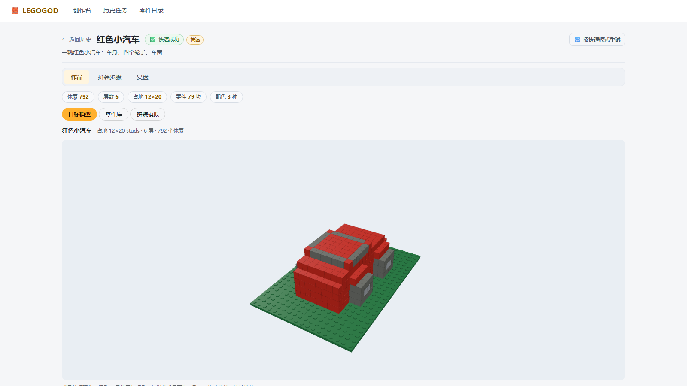
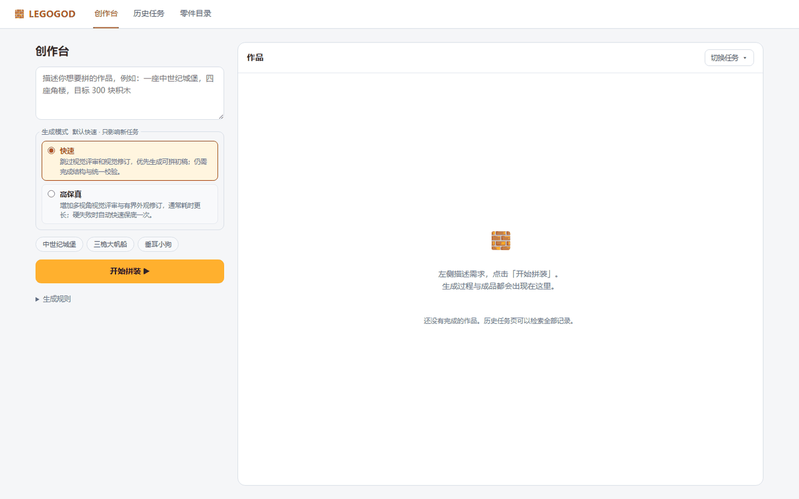
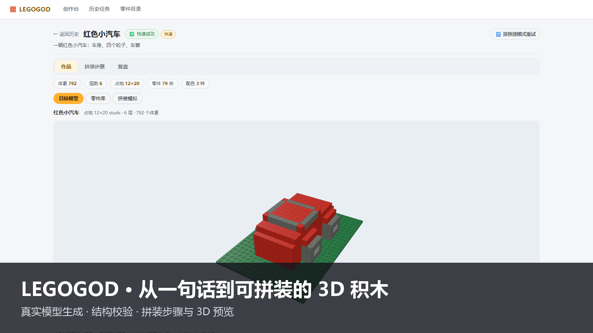
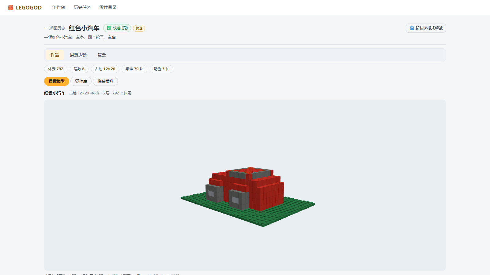
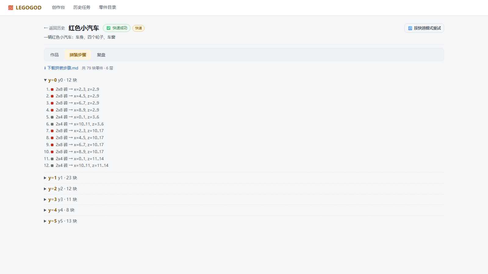
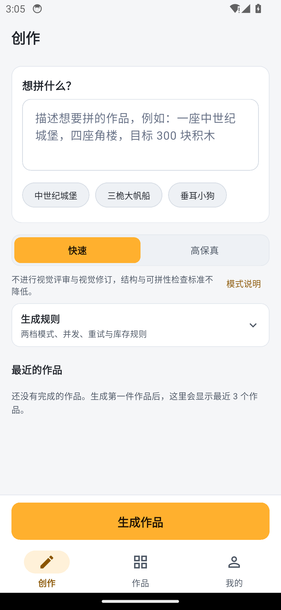
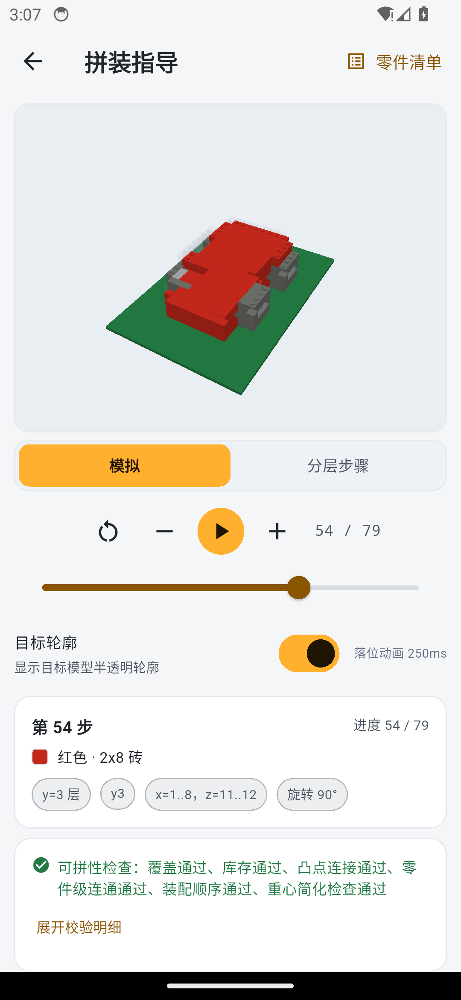

# LEGOGOD · 把一句话变成可拼装的 3D 积木作品

[](https://github.com/jensen666/legogod/actions/workflows/ci.yml)
[](LICENSE)
[](pyproject.toml)

**输入一句话，生成可查看、可校验、可一步步拼装的 3D 积木作品。**

LEGOGOD 不是让模型直接"画"出积木。模型只产出结构化设计，程序用固定的主链完成部位检查、精确铺砖求解与统一校验，最后输出带零件清单的拼装步骤和可旋转的 3D 视图。生成完成后，你可以检查每一层、每一块砖的位置，以及它为什么能拼得起来。





> 演示素材来自本仓库同一版本的真实运行；长等待过程已加速。完整演示视频见 [Releases](https://github.com/jensen666/legogod/releases)。

[](https://github.com/jensen666/legogod/releases)

## 为什么值得试用

- **固定程序主链，不是一次性抽卡**：模型输出受限协议，程序负责编译、门禁、预检、求解与统一校验；不通过校验就如实失败，不把"看起来像"当成"拼得起来"。
- **真的能拼**：每块砖都按真实凸点连接关系求解，覆盖、库存、零件级连通、装配顺序、悬吊物理与稳定性逐项校验。
- **双生成模式**：快速模式优先拿到可拼初稿；高保真模式增加多视角视觉评审与有界外观修订，硬失败时自动快速保底一次。
- **从作品到说明书**：自动生成分层拼装步骤（含预拼子模块）与零件清单，3D 视图可逐层回放。
- **Web + Android**：浏览器端完整创作/历史/3D/步骤；Android APP 连接同一服务端 API，原生 3D 渲染，不使用 WebView 包整站。

## 真实效果





所有截图来自同一真实任务：需求 → 模型生成 → 结构校验 → 精确求解 → 步骤与 3D 产物。生成质量存在波动，项目不会挑选结果后宣称普遍成功率。

## 60 秒快速开始

环境：Python 3.10+，以及一个兼容 OpenAI Chat Completions 协议的模型服务（需自备）。

```bash
# 1. 安装（完整功能，含 Pillow 渲染）
python -m pip install -e ".[pillow]"

# 2. 配置模型：复制模板并填入你的服务地址、密钥与模型名
cp .env.example .env        # Windows: Copy-Item .env.example .env

# 3. 启动
python -m legogod
```

打开 <http://127.0.0.1:8600>，输入需求（例如"一座中世纪城堡，四座角楼，目标 300 块积木"），选择生成模式，点击「开始拼装」。

- 只跑快速链路、不需要渲染时，用基础安装 `python -m pip install -e .`。
- 开发与测试：`python -m pip install -e ".[pillow]"` 后 `python -m pip install -r requirements-dev.txt`。
- 详细步骤与常见问题见 [快速开始](docs/quickstart.md)；部署与安全见 [部署与安全](docs/deployment.md)。
- 图表分析工具另需 `matplotlib`/`numpy`（可选，不进入默认测试）。

## 它如何工作

```text
需求 → 模型规划与设计（受限 JSON 协议）
     → 程序编译体素 + 部位绑定 + 部位突显门禁
     → 设计预检（支撑/连通/规模）
     → 精确铺砖求解（库存 + 凸点连接 + 错缝）
     → 统一校验（覆盖/库存/连接/连通/装配/悬吊/稳定性）
     → 拼装步骤 Markdown + 3D 视图
```

模型负责"想"，程序负责"能不能拼"。完整说明见 [工作原理](docs/architecture.md)。

## Web 与 Android

| 端 | 能力 | 说明 |
|---|---|---|
| Web | 创作台、历史任务、任务详情（3D / 拼装步骤 / 运行记录）、零件目录 | 桌面端多页面，页面有独立 URL；3D 使用 Three.js（固定版本 CDN，首次加载需联网） |
| Android APP | 创作、作品列表与搜索、3D 作品、分层拼装指导、零件清单、生成记录 | Flutter 原生实现，连接真实服务端 API v1；构建与版本见 [app/README.md](app/README.md) |

Android 当前只提供 Android 工程（不支持 iOS 构建与签名）。真机自动化验收范围与未覆盖项在 APP 文档中如实记录。

| Android · 创作 | Android · 分层拼装指导 |
|---|---|
|  |  |

## 测试

```bash
python -m pip install -e ".[pillow]"
python -m pip install -r requirements-dev.txt
python -m pytest test -q
```

- 核心测试不调用真实模型；渲染相关用例需要 Pillow。
- 前端部分测试需要 Node.js。
- 公开 CI 会校验公开测试夹具清单（数量与 SHA-256），并禁止静默跳过用例。
- 真实 LLM E2E、长时间浏览器 E2E 与真机 E2E 不在默认 CI 中运行。

## 安全与已知限制

- 模型密钥只放在本地 `.env` 或环境变量，不写入页面与仓库；`.env` 已被忽略规则排除。
- 服务默认监听回环地址；监听非回环地址必须配置访问令牌，公网部署需要 HTTPS 同源反向代理。详见[部署与安全](docs/deployment.md)。
- 生成质量存在波动：真实模型产出可能降级、保底或失败；固定主链保证"不通过校验就不算成功"，不保证每个需求一次成功。
- 单任务 30 分钟硬墙钟；当前实例边界是单个 API 进程 + 单个任务历史文件。
- 项目需要用户自备 LLM 服务，不对第三方模型可用性做承诺。

安全漏洞请走 [SECURITY.md](SECURITY.md) 的私有报告渠道，不要公开提交。

## 贡献

欢迎 Issue 与 Pull Request。[CONTRIBUTING.md](CONTRIBUTING.md) 说明环境准备、测试要求、文档同步与媒体/隐私规范。代码贡献在 MIT 许可证下发布。

## 许可与声明

- 本项目采用 [MIT License](LICENSE)，版权归 LEGOGOD contributors。
- 第三方依赖与素材许可见 [THIRD-PARTY-NOTICES.md](THIRD-PARTY-NOTICES.md)。
- **本项目是独立开源项目，与 LEGO Group 无隶属、赞助或背书关系；LEGO® 及相关商标归原权利人所有。** 项目不使用官方 Logo，也不把产物包装成官方产品。
